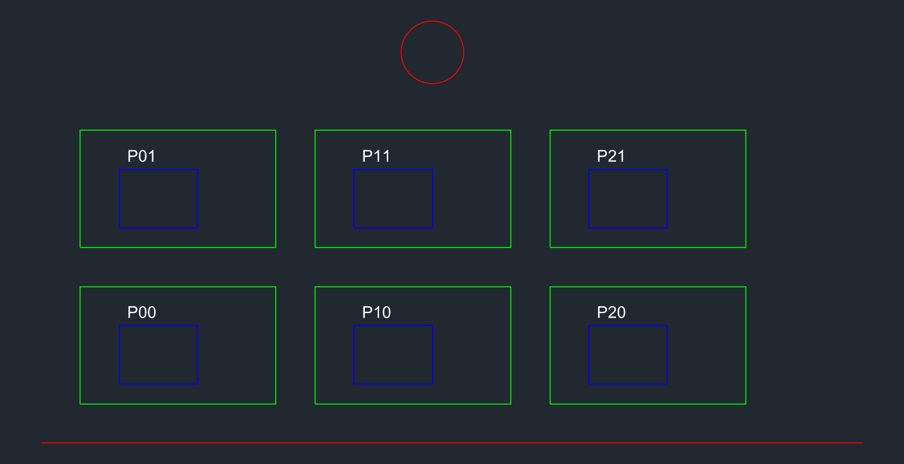
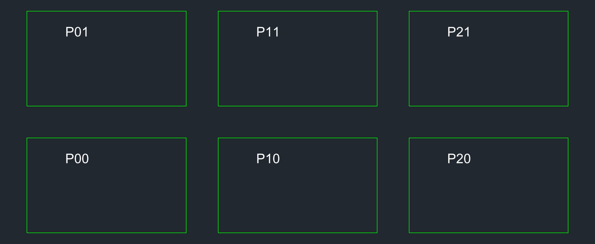

# dwg-to-webgis

یک [اسکیل (Skill)](https://skills.sh) برای Claude Code و ایجنت‌هایی که `SKILL.md` را می‌خوانند. این اسکیل به دستیار هوش مصنوعی یاد می‌دهد **نقشه‌های DWG/DXF اتوکد را به نقشهٔ وب‌جی‌آی‌اس (Web GIS) تبدیل کند**:

```
DWG ──► DXF ──► بررسی و رندر ──► تعیین سیستم مختصات ──► GeoPackage / GeoJSON ──► (PMTiles) ──► نقشهٔ وب MapLibre
        اتوکد     ezdxf + PNG        EPSG تأییدشده توسط کاربر   GDAL / pyogrio       tippecanoe     صفحهٔ استاتیک
        یا ODA    (ایجنت نقشه را می‌بیند)
```

[English](README.md)

## این پروژه چیست و چه نیست

این مخزن فقط **دستورالعمل + یک اسکریپت کمکی** دارد. خودش GDAL، اتوکد یا مبدل را همراه ندارد. اسکیل به ایجنت یاد می‌دهد کار را *چطور و با چه احتیاطی* انجام دهد، و ایجنت بعد ابزارهایی را اجرا می‌کند که **تو نصب کرده‌ای** (لیست پایین).

چرا لازم است؟ چون فایل CAD «نقشهٔ کشیده‌شده» است، نه داده‌ی مکانی، و سه چیز معمولاً خراب می‌شود:

1. **DWG/DXF سیستم مختصات قابل‌اعتماد ندارد.** اسکیل ایجنت را وادار می‌کند CRS را بپرسد (نه حدس بزند) و جایگذاری را با نقطهٔ کنترل راستی‌آزمایی کند.
2. **واحد** (متر / میلی‌متر / فوت) به‌راحتی اشتباه می‌شود. اسکیل آن را بررسی و ضریب مقیاس را ثبت می‌کند.
3. **معنای CAD با معنای GIS فرق دارد.** پلی‌لاین بستهٔ CAD در GDAL «خط» می‌شود، نه پلیگان؛ لایه‌ها، بلوک‌ها و متن‌ها باید آگاهانه نگاشت شوند.

ایجنت همچنین می‌تواند **نقشه را شبیه اتوکد ببیند** (رنگ لایه‌ها، متن، نمایش تک‌لایه) چون DXF را به PNG رندر می‌کند و کار خودش را وارسی می‌کند.

## پیش‌نیازها (چه چیزهایی باید نصب شود)

| ابزار | برای چه | الزامی؟ | نصب |
|---|---|---|---|
| ایجنتی که `SKILL.md` را بارگذاری کند (مثل [Claude Code](https://claude.com/claude-code)) | اجرای اسکیل | بله | مستندات خودش |
| **Python 3.10+** | اسکریپت‌های رندر و تبدیل | بله | [python.org](https://www.python.org/downloads/) |
| **ezdxf** | خواندن DXF و رندر به PNG | بله | `pip install ezdxf` |
| **matplotlib** | موتور رندر PNG | بله | `pip install matplotlib` |
| **geopandas, pyogrio, shapely, pyproj** | تبدیل به GeoPackage/GeoJSON و مدیریت CRS. بستهٔ `pyogrio` خودش GDAL **همراه درایور DXF** دارد | بله | `pip install geopandas pyogrio shapely pyproj` |
| **اتوکد** *یا* **ODA File Converter** | تبدیل DWG به DXF (GDAL بدون درایور تجاری DWG را نمی‌خواند) | بله، برای ورودی `.dwg` | اتوکد (لایسنس‌دار) / [ODA File Converter](https://www.opendesign.com/guestfiles/oda_file_converter) (رایگان) |
| **ابزارهای خط فرمان GDAL** (`ogr2ogr`، `ogrinfo`) | روش خط فرمان؛ با `pip` نصب **نمی‌شوند** | اختیاری | [QGIS](https://qgis.org) / OSGeo4W / conda-forge (`gdal`) / کانتینر رسمی GDAL |
| **tippecanoe** و **pmtiles** | تایل برداری برای داده‌های حجیم | اختیاری | [tippecanoe](https://github.com/felt/tippecanoe) (در ویندوز با WSL یا conda)، [pmtiles](https://github.com/protomaps/go-pmtiles) |
| یک وب‌سرور استاتیک | پیش‌نمایش نقشه (از `file://` استفاده نکن) | اختیاری | `python -m http.server` |

نصب پایتونیِ یک‌خطی:

```bash
python -m pip install ezdxf matplotlib geopandas pyogrio shapely pyproj
```

> **نکتهٔ ویندوز:** مسیرهای خیلی طولانی (بیش از ۲۶۰ کاراکتر) باعث خطای «The directory name is invalid» می‌شوند. در مسیر کوتاه مثل `C:\work\gis` کار کن.

## نصب اسکیل

با [skills CLI](https://skills.sh):

```bash
npx skills add imerfs/dwg-to-webgis-skill --skill dwg-to-webgis -g
```

یا دستی: پوشهٔ `skills/dwg-to-webgis/` را در پوشهٔ اسکیل‌های ایجنت کپی کن (برای Claude Code: `~/.claude/skills/dwg-to-webgis/`) و ایجنت را دوباره اجرا کن.

## طرز استفاده

به زبان ساده از ایجنت بخواه، مثلاً:

> «فایل `parcels.dwg` را به نقشهٔ وب تبدیل کن. نقشه در UTM زون ۳۹ شمال (EPSG:32639) است.»
>
> «نشانم بده در هر لایهٔ `site-plan.dxf` چه چیزی هست.»

ایجنت این مراحل را دنبال می‌کند (جزئیات کامل در [`SKILL.md`](skills/dwg-to-webgis/SKILL.md)):

1. **اول می‌پرسد:** CRS/EPSG، واحد نقشه، لایه‌های مهم، هدف (سایت استاتیک یا سرور) و یک نقطهٔ کنترل. اگر CRS نامعلوم باشد، به‌جای حدس زدن فقط پیش‌نمایش با مختصات محلی می‌دهد.
2. **DWG به DXF** با اتوکد (`DXFOUT`) یا ODA File Converter. فایل DWG اصلی هرگز بازنویسی نمی‌شود.
3. **بررسی:** جدول لایه‌ها و تعداد موجودیت‌ها، و **رندر** نقشه (کل، سپس لایه‌به‌لایه) به PNG و دیدن آن:
   ```bash
   python -I skills/dwg-to-webgis/scripts/render_dxf.py input.dxf --list
   python -I skills/dwg-to-webgis/scripts/render_dxf.py input.dxf all.png
   python -I skills/dwg-to-webgis/scripts/render_dxf.py input.dxf parcels.png --layers PARCELS,TEXT --dpi 200
   ```
4. **تبدیل** به GeoPackage (فرمت کاری) و GeoJSON (وب)، با برچسب‌زدن صریح CRS مبدأ، ساخت آگاهانهٔ پلیگان، حذف عناصر اضافی (قاب، ابعاد) و حفظ ستون `Layer`.
5. **اعتبارسنجی:** تعداد عارضه‌ها در هر لایه، قرارگیری محدوده در منطقهٔ مورد انتظار، تست نقطهٔ کنترل روی نقشهٔ پایه، و معتبر بودن هندسه‌ها.
6. **تایل** (فقط برای داده‌های حجیم): GeoJSONSeq ← tippecanoe ← PMTiles.
7. **انتشار** یک صفحهٔ MapLibre GL JS و یک README که فرض‌ها را ثبت می‌کند (CRS، واحد، ضریب مقیاس، لایه‌های نگه‌داشته/حذف‌شده، پلیگان‌های استنباطی، نتیجهٔ اعتبارسنجی).

### نمونهٔ رندر

ایجنت نقشه را تقریباً مثل اتوکد می‌بیند (رنگ لایه‌ها و متن) و می‌تواند لایه‌ها را جدا کند:

| کل نقشه | فقط `PARCELS` و `TEXT` |
|---|---|
|  |  |

بازتولید با نمونهٔ ساختگی: `python examples/make_sample.py` و سپس دستورهای رندر بالا.

## چه چیزی تست شده و چه چیزی نه

وضعیت صادقانه، تا بدانی به چه چیزی اعتماد کنی:

- **تست‌شده** روی یک DXF ساختگی (ساخته‌شده با `examples/make_sample.py`): فهرست لایه‌ها، رندر کل و تک‌لایه، خواندن با درایور DXF در GDAL از طریق `pyogrio`/`geopandas` (GDAL 3.12)، `set_crs` و خروجی GeoPackage و GeoJSON، و تبدیل به WGS 84.
- **رفتار مشاهده‌شدهٔ درایور DXF در GDAL** (در اسکیل ثبت شده): DXF سیستم مختصات ندارد؛ `LWPOLYLINE` بسته و `CIRCLE` به `LineString` تبدیل می‌شوند نه `Polygon`؛ `TEXT` می‌شود `Point`؛ نام لایهٔ CAD در ستون `Layer` است.
- **هنوز تست نشده:** فایل‌های DWG واقعی، تبدیل DWG به DXF با COM اتوکد یا ODA File Converter (آرگومان‌های خط فرمان از مستندات نوشته شده و در اسکیل برای راستی‌آزمایی علامت خورده)، خروجی tippecanoe/PMTiles، و صفحهٔ MapLibre روی داده‌های واقعی. این مراحل را راهنما بدان و خودت بررسی کن؛ لطفاً نتیجه را در Issue گزارش بده.

## محدودیت‌ها

- فقط **ModelSpace** را رندر می‌کند (نه layoutهای کاغذ، ضخامت‌های چاپی، یا xrefهای گم‌شده)؛ فونت‌های SHX ممکن است با اتوکد فرق کنند. اگر رندر و اتوکد اختلاف داشتند، اتوکد معتبر است.
- محدودهٔ هدر (`$EXTMIN/$EXTMAX`) ممکن است تنظیم‌نشده یا کهنه باشد؛ محدودهٔ واقعی از خود موجودیت‌ها حساب می‌شود.
- مدل‌های سه‌بعدی BIM/IFC و SolidWorks خارج از محدوده‌اند.
- اسکیل هرگز هندسه یا CRS نمی‌سازد. دقت جغرافیایی خروجی به اطلاعاتی که می‌دهی بستگی دارد.

## منابع و مجوز

این اسکیل از ایده‌ها و دستورهای دو اسکیل متن‌باز اقتباس کرده است:

- [`isaaccorley/geospatial-skills`](https://github.com/isaaccorley/geospatial-skills) (اسکیل `gdal`)، Apache-2.0
- [`jaakla/openmapstack-skills`](https://github.com/jaakla/openmapstack-skills) (اسکیل `open-map-stack`)، MIT

و مراحل مخصوص CAD، رندرکنندهٔ DXF و یادداشت‌های تست‌شده را اضافه کرده است. جزئیات در [`NOTICE`](NOTICE).

تحت [مجوز Apache 2.0](LICENSE).

Issue و Pull Request خوش‌آمد است، به‌ویژه گزارش تست با DWGهای واقعی.
