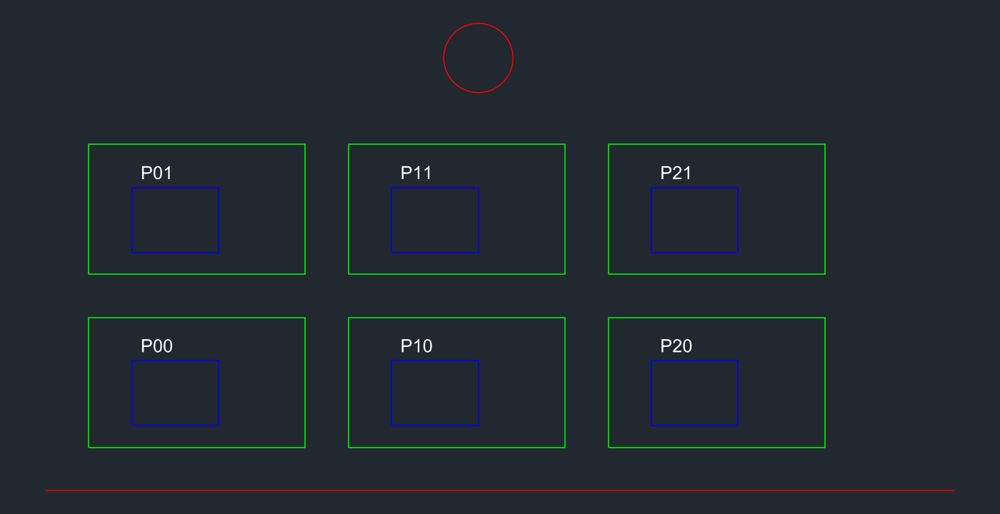
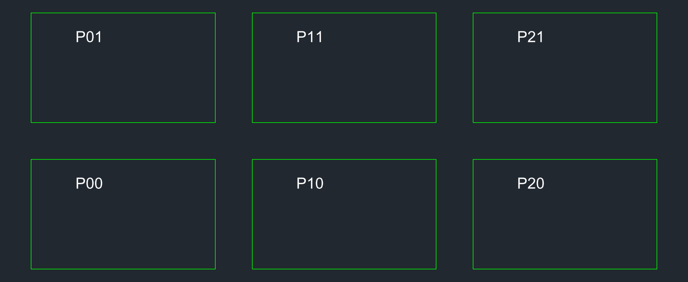

# dwg-to-webgis

An [agent skill](https://skills.sh) (for Claude Code and other agents that load `SKILL.md`) that guides an AI assistant through turning **AutoCAD DWG/DXF drawings into a working web GIS map**:

```
DWG ──► DXF ──► inspect & render ──► georeference (CRS) ──► GeoPackage / GeoJSON ──► (PMTiles) ──► MapLibre web map
        AutoCAD    ezdxf + PNG         user-confirmed EPSG       GDAL / pyogrio          tippecanoe      static page
        or ODA     (agent can look)
```

[فارسی](README.fa.md)

## What it is (and is not)

This repository contains **instructions plus one helper script**. It does not bundle GDAL, AutoCAD or any converter. The skill teaches the agent *how* to do the job safely, and the agent then runs the tools **you install** (listed below).

It exists because CAD files are drawings, not geodata, and three things routinely go wrong:

1. **A DWG/DXF has no reliable coordinate system.** The skill makes the agent ask for the CRS instead of guessing, and verify placement with a control point.
2. **Units** (m / mm / ft) are easy to get wrong. The skill checks them and records any scale factor.
3. **CAD semantics are not GIS semantics.** Closed polylines come out of GDAL as *lines*, not polygons; layers, blocks and text need deliberate mapping.

It also lets the agent **see the drawing like AutoCAD shows it** (layer colours, text, one layer at a time) by rendering the DXF to a PNG, so it can check its own work.

## Requirements

| Tool | Needed for | Required? | Install |
|---|---|---|---|
| An agent that loads `SKILL.md` (e.g. [Claude Code](https://claude.com/claude-code)) | Running the skill | Yes | see its docs |
| **Python 3.10+** | Rendering and conversion scripts | Yes | [python.org](https://www.python.org/downloads/) |
| **ezdxf** | Reading DXF, rendering to PNG | Yes | `pip install ezdxf` |
| **matplotlib** | PNG rendering backend | Yes | `pip install matplotlib` |
| **geopandas, pyogrio, shapely, pyproj** | Conversion to GeoPackage/GeoJSON, CRS handling. `pyogrio` wheels bundle GDAL **with the DXF driver** | Yes | `pip install geopandas pyogrio shapely pyproj` |
| **AutoCAD** *or* **ODA File Converter** | DWG → DXF (GDAL cannot read DWG without commercial drivers) | Yes, for `.dwg` input | AutoCAD (licensed) / [ODA File Converter](https://www.opendesign.com/guestfiles/oda_file_converter) (free) |
| **GDAL command-line tools** (`ogr2ogr`, `ogrinfo`) | CLI workflow; **not** installed by `pip` | Optional | [QGIS](https://qgis.org) / OSGeo4W / conda-forge `gdal` / official GDAL container |
| **tippecanoe** and **pmtiles** CLIs | Vector tiles for large datasets | Optional | [tippecanoe](https://github.com/felt/tippecanoe) (on Windows use WSL or conda), [pmtiles](https://github.com/protomaps/go-pmtiles) |
| A static file server | Previewing the web map (do not use `file://`) | Optional | `python -m http.server` |

One-line Python setup:

```bash
python -m pip install ezdxf matplotlib geopandas pyogrio shapely pyproj
```

> **Windows tip:** very long folder paths (> 260 characters) make Python/Windows fail with "The directory name is invalid". Work in a short path such as `C:\work\gis`.

## Install the skill

With the [skills CLI](https://skills.sh):

```bash
npx skills add imerfs/dwg-to-webgis-skill --skill dwg-to-webgis -g
```

Or manually, copy `skills/dwg-to-webgis/` into your agent's skills folder (for Claude Code: `~/.claude/skills/dwg-to-webgis/`) and restart the agent.

## How to use it

Ask your agent in plain language, for example:

> "Turn `parcels.dwg` into a web map. The drawing is in UTM zone 39N (EPSG:32639)."
>
> "Show me what is on each layer of `site-plan.dxf`."

What the agent will do (see [`skills/dwg-to-webgis/SKILL.md`](skills/dwg-to-webgis/SKILL.md) for the full workflow):

1. **Ask first:** CRS/EPSG, drawing units, which layers matter, target (static site or server), and a known control point. If the CRS is unknown it stops at a local-coordinate preview instead of guessing.
2. **DWG → DXF** with AutoCAD (`DXFOUT`) or ODA File Converter. The original DWG is never overwritten.
3. **Inspect:** layer table and entity counts per layer, and **render** the drawing (whole, then layer by layer) to PNG and look at it:
   ```bash
   python -I skills/dwg-to-webgis/scripts/render_dxf.py input.dxf --list
   python -I skills/dwg-to-webgis/scripts/render_dxf.py input.dxf all.png
   python -I skills/dwg-to-webgis/scripts/render_dxf.py input.dxf parcels.png --layers PARCELS,TEXT --dpi 200
   ```
4. **Convert** to GeoPackage (working format) and GeoJSON (web), labelling the source CRS explicitly, building polygons deliberately, dropping construction junk (title blocks, dimensions), and keeping the CAD `Layer` attribute.
5. **Validate:** feature counts per layer, extent inside the expected area, a control-point check on a basemap, valid geometries.
6. **Tiles** (only for large data): GeoJSONSeq → tippecanoe → PMTiles.
7. **Publish** a MapLibre GL JS page and a README recording the assumptions (CRS, units, scale factor, layers kept/dropped, inferred polygons, validation results).

### Example render

The agent sees the drawing roughly as AutoCAD would (layer colours, text), and can isolate layers:

| Whole drawing | `PARCELS` + `TEXT` only |
|---|---|
|  |  |

Reproduce with the synthetic sample: `python examples/make_sample.py` then the render commands above.

## What has and has not been tested

Honest status, so you know what to trust:

- **Tested** on a synthetic DXF (created by `examples/make_sample.py`): layer listing, whole-drawing and per-layer rendering, reading with GDAL's DXF driver through `pyogrio`/`geopandas` (GDAL 3.12), `set_crs` + export to GeoPackage and GeoJSON, reprojection to WGS 84.
- **Observed GDAL DXF behaviour** (recorded in the skill): DXF has no CRS; closed `LWPOLYLINE`s and `CIRCLE`s become `LineString`, not `Polygon`; `TEXT` becomes `Point`; the CAD layer is in the `Layer` column.
- **Not yet tested:** real-world DWG files, DWG → DXF with AutoCAD COM or ODA File Converter (command-line arguments are written from documentation and flagged in the skill for verification), tippecanoe/PMTiles output, and the MapLibre page against real data. Treat those steps as a guide to verify, and please open an issue with what you find.

## Limitations

- Renders **model space only** (not paper-space layouts, plotted lineweights, or missing xrefs); SHX fonts may differ from AutoCAD. If a render and AutoCAD disagree, trust AutoCAD.
- Header extents (`$EXTMIN/$EXTMAX`) can be unset or stale; real extents are computed from entities.
- 3D BIM/IFC and SolidWorks models are out of scope.
- The skill never invents geometry or a CRS. Output is only as georeferenced as the information you provide.

## Credits and license

This skill adapts ideas and recipes from two open-source skills:

- [`isaaccorley/geospatial-skills`](https://github.com/isaaccorley/geospatial-skills) (`gdal`), Apache-2.0
- [`jaakla/openmapstack-skills`](https://github.com/jaakla/openmapstack-skills) (`open-map-stack`), MIT

and adds the CAD-specific workflow, the DXF renderer, and tested notes. See [`NOTICE`](NOTICE) for details.

Licensed under the [Apache License 2.0](LICENSE).

Issues and pull requests are welcome, especially real-world DWG test reports.
